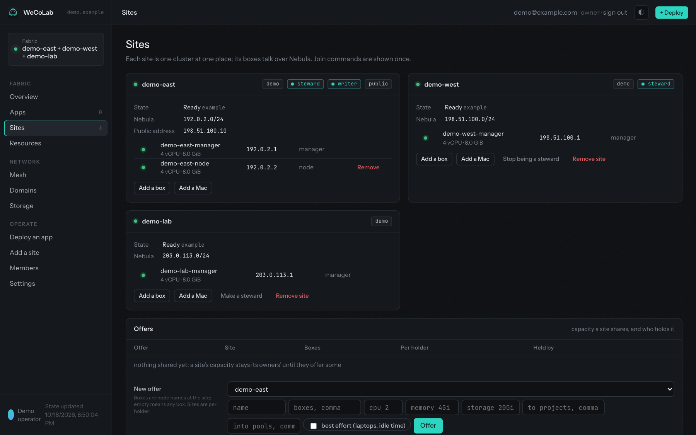

# WeCoLab

**A cooperative cloud for your own hardware.**

WeCoLab lets you and people you trust pool servers, homelabs and spare computers to host apps together.
Each location controls what it shares; you manage apps and capacity through a browser.

[Website](https://wecolabhq.github.io/wecolab/) · [Try locally](#try-locally) · [Documentation](https://wecolabhq.github.io/wecolab/docs/)

- **Share on your terms.** Choose how much CPU, memory and storage to offer your collaborators.
- **Run apps across locations.** Deploy containerized apps from the Console, without putting every machine in one place.
- **Keep another copy.** PostgreSQL-backed apps can have a standby at another location, with operator-controlled recovery rather than automatic failover.

*The Console's sites and resource-sharing view. Names and addresses shown are example data.*

## Try locally

**WeCoLab is in development; no release has been published yet.** Start with the
[disposable Docker lab](docs/development.md#a-whole-fabric-on-one-laptop), not a production machine.
It creates two sites, a laptop node and an object-storage vault on one machine, then prints site and node status.

The lab uses privileged Docker containers. Allow at least **30 GiB free in Docker's backing store**
for the full checks. Read the guide first for the required ownership settings, network selection and cleanup.
This is a development environment, not a production installation.

For real machines, the [installation guide](docs/install.md) explains prerequisites and release verification.
Do not run an installer from a moving branch as root; installation requires verified, immutable release artifacts.

## Learn more

- [Documentation](https://wecolabhq.github.io/wecolab/docs/) — the full guides, including the [Console](docs/console.md), [architecture](docs/architecture.md) and [operations](docs/operations.md).
- [Contribute](https://wecolabhq.github.io/wecolab/contribute/) — development, documentation, app integrations and recovery drills.
- [Questions and issues](https://github.com/WeCoLabHQ/wecolab/issues) — ask for help or report a problem.

Licensed under the [GNU Affero General Public License v3.0](LICENSE).
